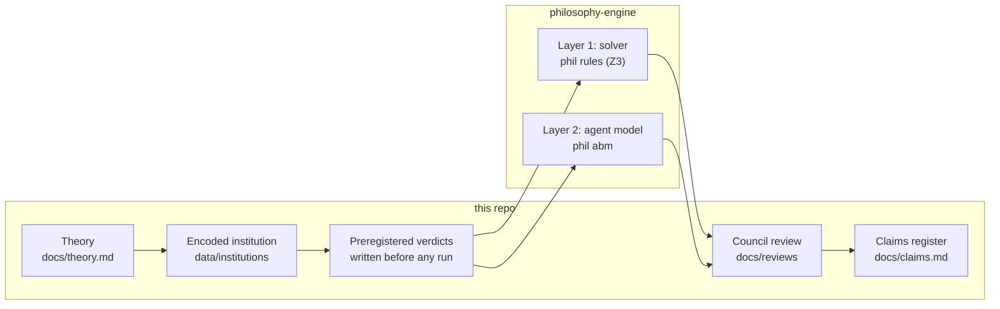
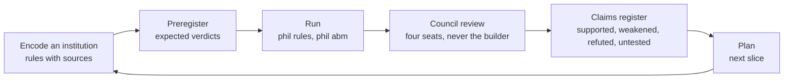

# computational-liberation

A theory of liberation, written so a computer can check it. The idea in one sentence: write institutions as rules, say in advance what should follow from those rules, let a solver check whether it does, and publish what survived.

Here an *institution* is anything that packages goods, roles or duties together by law, money or custom: a marriage law, a police encounter, a childcare rota.
The theory calls such a package a *bundle*.
Oppression, on this view, is a bundle that scarcity started, power added to, custom locked in, and that outlived its reasons.
Liberation is turning imposed bundles into chosen ones, starting with the people who have the least freedom.
The project's bet is that this can be made precise enough to be wrong: each institution is encoded as a small set of rules, the expected result of each check is written down before the check runs, and every result ships as a plain sentence plus the formal certificate behind it.
If you are new, read [docs/overview.md](docs/overview.md) first; it explains every term below with examples.

## How it fits together

Two repositories. This one holds the theory, the dataset of encoded institutions, the written expectations, the reviews and the register of claims. [philosophy-engine](https://github.com/reeswrites/philosophy-engine) holds the Python code that runs the checks.



*The pipeline: an institution is encoded as rules, its expected verdicts are written down, the engine checks them, fresh reviewers read the result, and the claims register records what it supports.*

The rule format is ADICO, Ostrom's Institutional Grammar: each rule names an Attribute (who), a Deontic (may, must, must not), an aIm (the action or state), Conditions (when) and an Or else (the sanction). The solver is Z3, an SMT (satisfiability modulo theories) solver: it searches for a sequence of steps that the rules allow and that reaches, keeps or breaks a named property. Design decisions are kept as ADRs (architecture decision records), numbered in one sequence across both repos.

**Key words, expanded once.** Every other document assumes these.

| Term | Expansion | Meaning here |
|---|---|---|
| ADICO | Attribute, Deontic, aIm, Conditions, Or else | Ostrom's rule grammar; the shape of every rule in the dataset |
| Z3 / SMT | an SMT (satisfiability modulo theories) solver | The program that searches for a rule-compliant sequence of steps |
| k | the step bound, default 6 | Every verdict is "within k steps"; beyond k nothing is claimed |
| ADR | architecture decision record | One decision per short file; changed only by a newer ADR |
| ABM | agent-based model | Layer 2: adaptive agents acting under the same rules |
| MWPA | Married Women's Property Acts | The first backtest case, a chain of six encodings |
| gate | a lettered set of pass criteria | Layer 1 has (a) to (f), layer 2 has (a) to (d) |

## The five layers

The roadmap in [docs/theory.md](docs/theory.md) ("Roadmap: making liberation computable") builds the tool in five layers. Each depends on the one before. No forward claim about any real institution is made until layer 3 passes.

| Layer | Question it answers | State |
|---|---|---|
| 1. Entailment | What does this rule set permit or force within a few steps? | Built: `phil rules`, gate (a) to (f) |
| 2. Frequency | How often do adaptive agents under those rules reach an outcome? | Built in part: `phil abm`, material module; coordination module and gate (a), (b) in progress |
| 3. Backtest | Do layers 1 and 2 reproduce known history? | Not started as a layer; one layer-1 backtest run (MWPA, see Status) |
| 4. Priority | Which change scores highest now? | Not started |
| 5. Sequence | What order should changes go in? | Not started |

The layer-1 gate is the project's test that the engine recovers findings people already trust, from the rules alone ([ADR 0007](docs/decisions/0007-dataset-clusters-pairs-and-gate.md)). Its six letters, from the [glossary](docs/glossary.md#gate):

| Letter | Checks that |
|---|---|
| (a) | Every institution loads, and no load-bearing must rule is inert (impossible to break) |
| (b) | Police, child protective services and the coverture household match at their precommitted level; the lease, the library and the naming game do not; the crisis team matches nothing |
| (c) | The paternity-quota and transferable-leave pair is one rule apart and differs on the named property |
| (d) | The kibbutz property `care_assigned_by_sex` persists with the implicit rule and fails without it |
| (e) | Verdicts agree with preregistered expectations (minimum 60%) |
| (f) | Renaming owner to guardian is detected as a pure rename; guardianship is not ownership |

A pass proves fitness of the encodings and the engine on these cases. It is not evidence that the theory is true ([interpreting-results.md](docs/interpreting-results.md), section 4).

## What a result looks like

The kibbutz children's house is the dataset's clearest case ([data/institutions/README.md](data/institutions/README.md), "Batch 2").
In the classic kibbutz, children slept in a communal house and were cared for by a *metapelet*, a member assigned by a committee.
The encoding has eight rules.
R1 says the committee may assign any member; it is written sex-blind.
R2 says the committee must not assign a male member, with a reprimand as the sanction.
R2 is tagged `implicit: true`, because no by-law said this; the sources record it as a practice ("the nanny position was always a woman's role").

The preregistered expectation was that the property `care_assigned_by_sex` would read `persists` (once true, it stays true within the bound) in the original and `fails` in a twin encoding that is identical except for R2.
The engine confirmed both verdicts, and gate (d) names R2 as the one rule that separates the pair.
So far so good.

What the engine did and did not show, in the words of the claims register ([claims L6 and L19](docs/claims.md)): it identified which single rule carries the outcome, given rules that people wrote.
It did not discover that R2 is implicit; `implicit` is a hand tag that the engine hands back, and setting it to false changes no verdict.
The ablation bites only because R1 was written sex-blind.
And the verdict is about the encoding, not about any real kibbutz.
Claim L6 is therefore marked *weakened*, not supported.
The layer-2 gate (c) later ran the same pair with adaptive agents: at any positive sanction weight on the grid the forbidden assignment is excluded, and with R2 removed it is adopted wherever it pays ([plans/layer2-abm.md](plans/layer2-abm.md), "Gate run 2026-11-04").
That shows that sanctions bite in the model; it does not say where any real threshold lies.

## The process loop



*Every batch goes round this loop. Expectations are never edited to match results; disagreement is recorded ([CONTRIBUTING.md](CONTRIBUTING.md)). The council is [ADR 0014](docs/decisions/0014-review-council.md).*

## Status

Research in progress, 2026-11-04.
The honest summary is the [claims register](docs/claims.md); its tally line reads: supported 6, supported (encoding level) 1, weakened 9, refuted 1, untested 19, retracted 0 (36 rows).
The theory-level claims (layers 2 to 5) are untested by design, since no forward claim is made before layer 3; the one exception, T5 (cosmetic reform), is supported at the encoding level only.

The layer-1 gate (`phil rules gate`, criteria (a) to (f)) passes on the current 25-entry dataset (including the ectogenesis pair).
The first gate claim, that the engine rediscovers the care+control cluster from the rules alone, was weakened after the skeptical review (claim L1): the match depends on strand tags a human assigned.
The layer-2 gate (`phil abm gate`, criteria (a) to (d)) is recorded in [plans/layer2-abm.md](plans/layer2-abm.md): (c) kibbutz and (d) seed stability PASS; (a) footbinding and (b) committed minority were BLOCKED on a missing coordination module and two missing encodings, which are the slice now in progress ([docs/plan.md](docs/plan.md), "Next slice").
One backtest, the Married Women's Property Acts (MWPA), has run at layer 1: direction passed, every preregistered flip matched, failure modes reachable but unranked, so inconclusive until layer 2 ([plans/backtest-mwpa.md](plans/backtest-mwpa.md)).
Apache-2.0.

## Where to read next

**Start here**
- [Overview](docs/overview.md): the long plain-language explanation, with a real rule, the verdict vocabulary and a FAQ. For anyone with no context.
- [Intent](docs/intent.md): what this is for, what counts as liberation, and what would convince the author the frame is wrong. For anyone deciding whether to take the project seriously.
- [Glossary](docs/glossary.md): every term, with the gate letters in a table. Keep it open while reading anything else.

**Theory**
- [Theory](docs/theory.md) (snapshot of the canonical Claude doc; edit there, not here): core thesis, how oppression forms, how liberation starts, prioritizing, downstream consequences, precedents, non-human liberation. For readers who want the argument in full.
- [Plan](docs/plan.md): the thin path, what is parked, standing process, and a dated log of every batch. For anyone asking "what happens next".

**Evidence and process**
- [Claims register](docs/claims.md): one row per claim, with evidence and status. The single honest summary; read it before quoting any result.
- [Interpreting results](docs/interpreting-results.md): how to read `phil rules` output without over-reading it. For anyone who will see engine output.
- [Reviews](docs/reviews/): council reports after each batch. For anyone checking whether a claim was challenged.
- [Contributing](CONTRIBUTING.md): how to add an institution, the preregistration rule, dual-use limits.

**Decisions**
- [Decisions (ADRs)](docs/decisions/): theory and process decisions; engine-mechanics ADRs are indexed there and live in philosophy-engine. For anyone asking "why was it done this way".
- [Plans](plans/): institutions Phase 0, batch 2, backtest data inventory, the MWPA backtest, layer 2 agent-based model. Working documents, dated.

**Data**
- [Institutions dataset README](data/institutions/README.md): the 25 encodings, conventions, every revision and why. For anyone reading or adding an encoding.

**Engine**
- [philosophy-engine](https://github.com/reeswrites/philosophy-engine): the engine that formalizes, checks (Z3) and compares arguments and institutions. This repo supplies the theory and the `data/institutions` family; the engine supplies the code. Its README has the command table and the module diagram.

## Run

This repo has no code of its own. It depends on philosophy-engine as an editable uv path dependency at `../philosophy-engine`, so check both out as siblings:

```
git clone https://github.com/reeswrites/philosophy-engine
git clone https://github.com/reeswrites/computational-liberation
cd computational-liberation
uv sync
uv run phil families            # lists data/*/ families found here
uv run phil rules check-all     # every institution's expected verdicts against Z3
uv run phil rules gate          # layer-1 rediscovery gate, criteria (a) to (f); exit 0 = PASS
uv run phil rules iso --all --with-strands --cond guard   # isomorphism matrix and the dataset's expectations
uv run phil abm run --inst kibbutz-childrens-house --seeds 20   # layer 2: rates over seeds, material module
uv run phil abm gate --seeds 100                               # layer-2 gate, criteria (a) to (d); (d) needs 100 seeds
```

`phil rules check --inst ID --trace` prints the counterexample trace for one institution;
`phil abm sweep` and `phil abm score` are described in the engine README.
The engine resolves `data/` and `runs/` from the current working directory (`PHIL_DATA_DIR` / `PHIL_RUNS_DIR` override), so run `uv run phil ...` from inside this repo.
The dataset lives in `data/institutions/` here (25 entries); the engine repo carries a synced copy (it has "Sync dataset" commits).
Sync direction: see [data/institutions/README.md](data/institutions/README.md).

## What the engine does and doesn't do

- It identifies which single rule carries an outcome, given encodings that people wrote (third review, claims L19).
- It does not discover that a rule is implicit; `implicit` is a hand tag the engine hands back.
- It does not draw the care/control line itself; the cluster match reads strand tags a human assigned.
- Strand and implicit tags are human inputs the engine reports back, and the care/control match depends on them (an `airline-flight` control also matches; retagging its care rule removes every match).
- A kibbutz or cluster verdict is a statement about the encoding, not about the institution.

## Process

Expected verdicts are preregistered before any run and never edited to match results; disagreement is recorded ([CONTRIBUTING.md](CONTRIBUTING.md)). After every batch a council of fresh agents, never the builder, reviews correctness, consistency, scope and encoding faithfulness ([ADR 0014](docs/decisions/0014-review-council.md)); its reports go in [docs/reviews/](docs/reviews/) and the claims register is updated from them.
