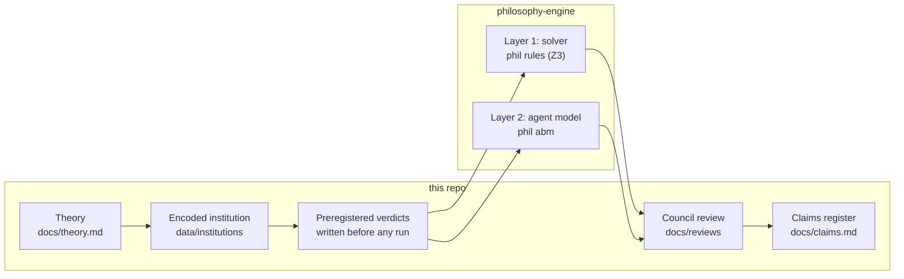
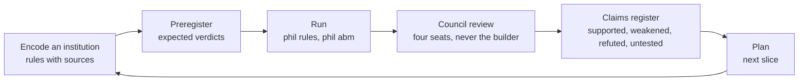

# computational-liberation

A theory of liberation, written so a computer can check it. Write an institution as rules, say in advance what should follow from those rules, let a solver check whether it does, and publish what survived.

Here an *institution* is anything that packages goods, roles or duties together by law, money or custom: a marriage law, a police encounter, a childcare rota.
The theory calls such a package a *bundle*.
Oppression, on this view, is a bundle that scarcity started, power added to, custom locked in, and that outlived its reasons.
Liberation is turning imposed bundles into chosen ones, starting with the people who have the least freedom.
If you are new, read [docs/overview.md](docs/overview.md) first; it explains every term below with examples.
Current status and where to pick up: [docs/plan.md, "Where to pick up"](docs/plan.md#where-to-pick-up-updated-2026-11-06-end-of-session).

## Why compute this

Liberation movements face a sequencing problem that argument alone cannot settle. A bundle has many strands. Cut one and the others still hold; worse, the remaining strands now carry the load the cut strand carried, and the bundle may re-form around them. The Married Women's Property Acts gave wives their earnings but left the care obligation, so the result was a wife who worked for wages and still kept house (the dataset calls this `double_burden`). Husbands then parked assets in wives' names to dodge creditors (`creditor_shield`). Each reform was real and each left the bundle standing, carried by whatever strands remained.

The author's working thesis is that unbundling has to be simultaneous where it can be, because every surviving strand after a partial cut is more load-bearing than before and harder to cut next. That is a claim about structure, and structure can be checked. Given the rules of an institution written down, a solver can answer: which rule carries which freedom; what happens to the others when one is deleted; which set of rules has to go together for a freedom to appear and stay; and where two people who agree on the rules disagree about what follows. None of that tells you what to do. It tells you what the rules, as written, force and permit, within a bounded number of steps, so that the argument about what to do starts from a shared map.

The project's bet is that this can be made precise enough to be wrong. Each institution is a small set of rules with sources. The expected verdict of every check is written down and committed before the check runs. Every result ships as a plain sentence plus the formal certificate behind it, and a council of fresh reviewers reads it before the claims register records it.

## How it fits together

Two repositories. This one holds the theory, the dataset of encoded institutions, the written expectations, the reviews and the register of claims. [philosophy-engine](https://github.com/reeswrites/philosophy-engine) holds the Python code that runs the checks.



The rule format is ADICO, Ostrom's Institutional Grammar: each rule names an Attribute (who), a Deontic (may, must, must not), an aIm (the action or state), Conditions (when) and an Or else (the sanction). The solver is Z3, an SMT (satisfiability modulo theories) solver: it searches for a sequence of steps that the rules allow and that reaches, keeps or breaks a named property. Design decisions are kept as ADRs (architecture decision records), numbered in one sequence across both repos.

| Term | Expansion | Meaning here |
|---|---|---|
| ADICO | Attribute, Deontic, aIm, Conditions, Or else | Ostrom's rule grammar; the shape of every rule in the dataset |
| Z3 / SMT | an SMT (satisfiability modulo theories) solver | The program that searches for a rule-compliant sequence of steps |
| k | the step bound, default 6 | Every verdict is "within k steps"; beyond k nothing is claimed |
| ADR | architecture decision record | One decision per short file; changed only by a newer ADR |
| ABM | agent-based model | Layer 2: adaptive agents acting under the same rules |
| MWPA | Married Women's Property Acts | The historical rules trail: coverture cut one strand at a time |

## Forms of liberation

The theory names three conditions of equal standing and the dataset turns each into properties a solver can check. A *property* is a formula over the state of the institution; a *freedom property* is one whose violation is good news for the subject.

| Form | What it means | Properties in the dataset | What the rules have to do |
|---|---|---|---|
| **Exit** | You could leave and be all right | `subject_cannot_exit`, `dependent_cannot_exit`, `..._persists` | Delete the disability on leaving (coverture R6, police R4, CPS R10); add a floor so leaving is survivable |
| **Standing** | You can act in your own name: sue, contract, hold | `no_standing`, `cannot_contract` | Delete the disability (coverture R7) or add the grant (sole-trader R15, suit act R16) |
| **Material independence** | The means of your life are not held at another's will | `financial_dependence`, `financial_dependence_unpropertied` | Two routes: title (grant the power to hold property and keep earnings, delete the other party's control: the MWPA route) or a floor (the institution must provide, no title needed). Only the title route is encoded so far |
| **Bodily and reproductive autonomy** | Your body is not someone else's input | `binding_practised`, `marriage_requires_binding`, `reproduction_controlled_by_owner`, `offspring_owned` | Delete the rule that ties marriageability to the practice; delete the owner's power over breeding |
| **Care decoupled from sex and birth** | Who cares is chosen, not assigned by body | `care_assigned_by_sex`, `care_duty_on_women`, `female_parent_care_persists`, `care_decoupled_from_birth` | Delete the implicit sex rule (kibbutz R2); substitute the rival input (ectogenesis); reassign the obligation |
| **Non-domination** | No one can interfere at will, whether or not they do | `care_and_sanction_same_role` (structure), derived powers `can_sanction`, `can_claim_for` | Separate care from the power to sanction; make the carer's power conditional on the subject |
| **Recognition** | Care counts as work | not yet encoded | Needs goods properties and a value strand; slice 2 of [plans/priority.md](plans/priority.md) |
| **Voice** | Real say, including in rare high-stakes decisions | not yet encoded | Needs rules about who may change rules (Ostrom) |

Exit, standing and material independence are the liberties and powers of a single subject. Material independence is not property: the MWPA chain reached it through title because title was the vehicle on offer, and the theory's own sequence puts a decommodified floor ahead of it. Whether the floor route leaves fewer load-bearing strands than the title route is a cut-set question the dataset cannot yet ask, because no floor variant is encoded. Care decoupling and non-domination are about the shape of the bundle itself. Recognition and voice are the theory's gaps in the dataset, and they are where the next encodings go.

## Rules and what follows from them

Every institution is a handful of ADICO rules over a few roles, fluents (facts that change) and actions (things that change them). The kinds of rule matter more than the count, because each kind does something different to freedom.

| Rule kind | ADICO shape | What it does | Example |
|---|---|---|---|
| **Grant of power** | `may A when C` | Creates a capacity the subject did not have; a derived power `can_A` reads true while `C` holds | sole-trader R15: wife may contract |
| **Obligation** | `must A when C`, with `or_else` | Forces an action (fires at step t, effect at t+1) or a state (holds at the same step, ADR 0009) | ectogenesis R5: female parent must provide care |
| **Prohibition** | `must_not A when C`, with `or_else` | Bars an action on pain of a sanction; still a choice if the sanction is bearable | kibbutz R2: committee must not assign a man, or else reprimand |
| **Disability** | `must_not A when C`, `or_else` null | No power exists; the action cannot happen while `C` holds | coverture R7: wife must not contract while married |
| **Implicit rule** | any of the above, tagged `implicit: true` | A practice no text states; the tag is a hand input the engine hands back | kibbutz R2 |
| **Liberty vs power** | `liberty: true` on an action | A liberty is free unless a disability bars it; a power exists only when a rule grants it (ADR 0013) | contracting is a liberty; keeping earnings under coverture is a power |

Each rule also carries a *strand* tag from the theory: `rival` (one body, one input), `superadditive` (cheap because of something else), `tying` (no production link; glued on by power). The tags are human inputs. The engine reports them back and matches institutions on them; it does not discover them.

What the solver can say about a property, within k steps:

| Verdict | Meaning | What it is not |
|---|---|---|
| `reachable` | some rule-compliant path makes it true | a prediction that it will happen |
| `open` | no path within k | "safe"; beyond k nothing is claimed |
| `holds_to_k` | true at every step on every path | a theorem about the real institution |
| `violated` | some path breaks it | a frequency |
| `persists` | once true, stays true | stability under adaptive agents (that is layer 2) |
| `inconsistent` | the rules contradict each other | a verdict about the property |

Two more kinds of entailment are the ones the project cares about most:

- **Minimal pairs and isomorphism.** Two encodings one rule apart that differ on a named property show which rule carries it. Two encodings that match under a renaming of roles are the same institution wearing different words (owner renamed guardian), which is how cosmetic reform is caught.
- **Ablation and load.** Delete one rule, rerun every property, and count which freedom properties flip in which direction. A rule's `load_freedom` is how many freedoms it carries. A rule whose deletion flips nothing may still be load-bearing in a pair with another rule; that is the simultaneous-cut question, and it is the priority layer's whole job ([plans/priority.md](plans/priority.md)).

The second list is where the whack-a-mole thesis becomes testable. If deleting R7 alone leaves `cannot_contract` holding because R1 still routes everything through the husband, then R7 and R1 are a cut set, and reform that takes one without the other has not taken either.

## What a liberatory rule change looks like

Every historical reform in the dataset is one of a small number of edits to a rule set. Listing them is the start of a catalogue of moves, and each move has a known way of failing.

| Move | Rule edit | Historical instance | How it fails |
|---|---|---|---|
| **Remove a disability** | delete `must_not ... or_else null` | MWPA: wife may contract (R7 deleted) | the freed action is still gated by another rule (R1) |
| **Grant a power** | add `may A` | earnings acts (R14), suit act (R16) | the power is granted but the obligation that made it needed is untouched (`double_burden`) |
| **Add an exit** | add `may leave`, delete the bar | no-fault divorce | exit is formally open but materially impossible (no floor); a revocable exit changes nothing |
| **Separate care from sanction** | move `can_sanction` to a different role | unarmed crisis team instead of police | the new role inherits the sanction power under a new name |
| **Delete the implicit rule** | drop the tagged practice | kibbutz without the women-only rule | the written rule was sex-blind all along; deleting the tag changes no verdict unless the practice was encoded |
| **Substitute the rival input** | add an action that produces the good without the body | ectogenesis replacing gestation | the obligation downstream (R5: who must care) does not move with the input |
| **Floor** | add `must provide ... when subject` on the institution, not the carer | decommodified care, health, income | the floor is added to one role (women) and becomes a new tying strand |
| **Assurance** | add a pledge that conditions the norm on others | footbinding pledge associations | the pledge binds a minority below the tipping point |
| **Rules for changing rules** | add `may change_rule when ...` | Ostrom's commons principles | not yet encoded; voice is the dataset's gap |

The failure column is the part the engine is for. Each failure is a property: `double_burden`, `creditor_shield`, `backlash`, the rename test, `care_duty_on_women`. A reform is checked not by whether it reaches the freedom but by whether it reaches the freedom and leaves every failure mode open.

## The five layers

The roadmap in [docs/theory.md](docs/theory.md) builds the tool in five layers. Each depends on the one before. No forward claim about any real institution is made until layer 3 passes.

| Layer | Question it answers | State |
|---|---|---|
| 1. Entailment | What does this rule set permit or force within a few steps? | Built: `phil rules`, gate (a) to (f) passes on 25 entries |
| 2. Frequency | How often do adaptive agents under those rules reach an outcome? | Frozen 2026-11-04 after an honest gate record; see [plans/layer2-abm.md](plans/layer2-abm.md) |
| 3. Backtest | Do the layers reproduce known history? | One layer-1 backtest (MWPA chain), inconclusive without layer 2 |
| 4. Priority | Which rule carries the most freedom; which rules must go together? | In progress as rule ablation; [plans/priority.md](plans/priority.md) |
| 5. Sequence | What order should changes go in, given that partial cuts shift load? | Not started; depends on 4 |

The current work is layer 4 at layer-1 strength: ablation over every rule of every entry, two loads (freedom and goods) that are never summed, a transfer graph of where load moves when a rule is cut, and simultaneous-safe cut sets. The honest tally of what has been shown is the [claims register](docs/claims.md); read it before quoting any result. Nothing comes out of the engine that was not encoded into it: its outputs are combinations and comparisons of the encodings, and every surprise so far has been an encoding error, not a finding ([what it can and cannot find](docs/interpreting-results.md), [surprise ledger](docs/surprises.md)).

## The process loop



Expectations are written and committed before any run and never edited to match results; disagreement is recorded as drift ([CONTRIBUTING.md](CONTRIBUTING.md)). After every batch a council of fresh agents, never the builder, reviews correctness, consistency, scope and encoding faithfulness ([ADR 0014](docs/decisions/0014-review-council.md)). Builder choices that were not preregistered are marked ASSUMED until the author ratifies them.

## What the engine does not do

- It does not discover that a rule is implicit, or which strand a rule is; both are hand tags it hands back.
- It does not say how often anything happens; a `reachable` verdict is one path, not a rate.
- It does not say anything beyond k steps; `open` is never "safe".
- A verdict is about the encoding, not about the institution the encoding is of. Encoding faithfulness is a council seat for that reason.
- It does not recommend. The priority layer ranks rules by what they carry; the choice of what to cut is political and stays with people.

## Where to read next

**Start here**
- [Overview](docs/overview.md): the long plain-language explanation, with a real rule, the verdict vocabulary and a FAQ.
- [Intent](docs/intent.md): what this is for, what counts as liberation, and what would convince the author the frame is wrong.
- [Glossary](docs/glossary.md): every term, with the gate letters in a table.

**Theory**
- [Theory](docs/theory.md) (snapshot of the canonical Claude doc; edit there, not here): core thesis, how oppression forms, how liberation starts, prioritizing, downstream consequences, precedents, non-human liberation.
- [Priority plan](plans/priority.md): the ablation design, loads, cut sets, the disagreement locator and the preregistered slices.
- [Connections](docs/connections.md): where the feminist, abolitionist, animal, disability, race and anarchist cases meet at the rule level; the forms-by-literature matrix with its holes; composition and voice as the missing pieces; four preregistered connection claims.
- [Plan](docs/plan.md): the thin path, what is parked, standing process, and a dated log of every batch.

**Evidence and process**
- [Claims register](docs/claims.md): one row per claim, with evidence and status. The single honest summary.
- [Interpreting results](docs/interpreting-results.md): how to read `phil rules` output without over-reading it.
- [Reviews](docs/reviews/): council reports after each batch.
- [Contributing](CONTRIBUTING.md): how to add an institution, the preregistration rule, dual-use limits.

**Decisions and data**
- [Decisions (ADRs)](docs/decisions/): theory and process decisions; engine-mechanics ADRs are indexed there and live in philosophy-engine.
- [Plans](plans/): working documents, dated: Phase 0, batch 2, the MWPA backtest, layer 2, ectogenesis, priority.
- [Institution cards](docs/cards/README.md): one page per encoding, generated: roles, the rules in plain English beside their formal form and source, pairs as one-line diffs. For anyone who wants to check an encoding without reading code.
- [Institutions dataset README](data/institutions/README.md): the 25 encodings, conventions, every revision and why.
- [philosophy-engine](https://github.com/reeswrites/philosophy-engine): the code. Its README has the command table and the module diagram.

## Run

This repo has no code of its own. It depends on philosophy-engine as an editable uv path dependency at `../philosophy-engine`, so check both out as siblings:

```
git clone https://github.com/reeswrites/philosophy-engine
git clone https://github.com/reeswrites/computational-liberation
cd computational-liberation
uv sync
uv run phil rules check-all                 # every institution's expected verdicts against Z3
uv run phil rules gate                      # layer-1 rediscovery gate, criteria (a) to (f); exit 0 = PASS
uv run phil rules ablate --k 6,8 --summary ablate-summary.json   # layer 4: per-rule loads and flips
uv run phil rules iso --all --with-strands --cond guard          # isomorphism matrix
uv run phil abm gate --seeds 100            # layer 2 (frozen; serial on macOS, about 20 to 45 minutes)
```

`phil rules check --inst ID --trace` prints the counterexample trace for one institution.
`phil rules diff --baseline data/verdicts-baseline.json` is the regression check: it recomputes every verdict and exits 1 if any committed verdict changed or vanished (CI runs it). `--scoreboard docs/scoreboard.md` appends one row per run to the scoreboard, a table the tools write and nobody types into; `phil rules ablate --scoreboard docs/scoreboard-ablate.md --prev PREV_SUMMARY` does the same for ablation runs (entries, rows, uncounted, inconsistent, k disagreements, top-rule changes against the previous summary).
The engine resolves `data/` from the current working directory, so run `uv run phil ...` from inside this repo.
The dataset lives in `data/institutions/` here (25 entries; the source is one YAML per institution in `data/institutions/src/`, with a plain-English line and a source on every rule, and `build.py` writes the JSON and the cards in `docs/cards/`; never hand-edit the JSON); the engine repo carries a synced copy.

Apache-2.0. Research in progress; nothing here is a finding about any real institution until the claims register says so.
