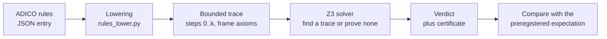
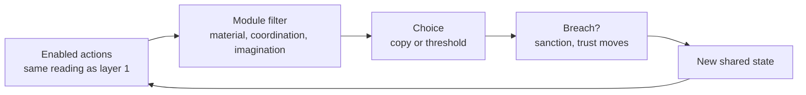

# Overview: the project explained from zero

This page is for someone who has never seen the project. It uses plain words, links every term to the [glossary](glossary.md), and ends with the questions that confused this page's author while reading. Nothing here is a result; results live in the [claims register](claims.md).

## 1. The problem in one page

Most of the arrangements people live under are packages. A job comes with income, insurance, a schedule and a boss. A marriage under coverture (the old English common-law rule) came with housing, care, the husband's control of property and no right to leave. The theory calls such a package a [bundle](glossary.md): goods, roles or duties tied together by law, money or custom.

Each thread in a bundle is a [strand](glossary.md), and the theory asks what holds each strand there. Three answers:

- **rival**: only one party can supply it at a time (one body, one pregnancy). A scheduling fact, not a value.
- **superadditive**: the good exists only because the parts come together (being known by one person who is also your housemate). Unbundling is possible but costs something.
- **tying**: glued on by law, wages or custom, with no production link to the rest. This is the strand that protects someone's monopoly and the one liberation removes first.

"Liberation" here has a narrow meaning: turning imposed bundles into chosen ones, so that [real freedom](glossary.md) and [non-domination](glossary.md) grow, starting with the people who have the least of them. Freedom is scored as exit, voice and recognition ([equal standing](glossary.md)); flourishing is scored separately; disagreement between the two is reported, not resolved ([intent.md](intent.md)).

The theory also says how bundles form (scarcity seeds one, power ties more on, norms lock it, imagination narrows, conditions change but the bundle stays) and how they break (surplus lets people see the bundle as a bundle, [assurance](glossary.md) lets them leave together). That is prose in [theory.md](theory.md). The rest of this page is about how the project tries to make those sentences checkable.

## 2. What an encoding is

An encoding is one institution written as a small set of rules in a JSON file, [data/institutions/institutions.json](../data/institutions/institutions.json). Each rule follows ADICO, Elinor Ostrom's Institutional Grammar ([ADR 0002](https://github.com/reeswrites/philosophy-engine/blob/main/docs/decisions/0002-rule-format-adico-json.md)). Here is a real rule, R2 of the kibbutz children's house, with its long `source` string shortened:

```json
{
  "id": "R2",
  "attribute": "committee",
  "deontic": "must_not",
  "aim": "(assign committee male_member)",
  "conditions": "true",
  "or_else": "R6",
  "strand": "tying",
  "implicit": true,
  "load_bearing": true,
  "source": "SANCTIONED NORM encoding a documented PRACTICE, not a written rule ... the nanny 'was always a woman's role' ..."
}
```

| Field | ADICO letter | What it says here |
|---|---|---|
| `attribute` | A, Attribute | Who the rule binds: the committee that staffs the children's house. |
| `deontic` | D, Deontic | `may`, `must` or `must_not`. Here: must not. |
| `aim` | I, aIm | The action (or, since [ADR 0009](https://github.com/reeswrites/philosophy-engine/blob/main/docs/decisions/0009-state-obligations.md), the state) the rule is about: assigning a male member. |
| `conditions` | C, Conditions | When the rule applies. `true` means always. |
| `or_else` | O, Or else | The sanction: rule R6, the committee's power to reprimand. `null` would mean a disability, a power that does not exist at all. |
| `strand` | (project metadata) | Why this rule is in the bundle: `tying`, a norm with no production link, per [ADR 0006](decisions/0006-strand-tags-bundles-implicit-rules.md). |
| `implicit` | (project metadata) | Nobody wrote this rule down; it is encoded because it is the one worth contesting ([implicit rule](glossary.md)). |
| `load_bearing` | (project metadata) | The gate counts on this rule to constrain behaviour; if nothing can ever break it, the gate fails ([inert](glossary.md)). |
| `source` | (project metadata) | What the encoder read, with URL, and `UNVERIFIED` where they could not confirm it. |

Around the rules, an entry also declares `roles` (committee, metapelet, male_member, child), `fluents` (facts that change over time, such as `provides_care` and `assigned`), `actions` with their effects on fluents, and `expected_properties`: the verdicts the encoder wrote down before running anything. A property is a formula over fluents; `care_assigned_by_sex` is `(forall ((x agent) (y agent)) (=> (provides_care x y t) (female x t)))`, "everyone providing care at step t is female". Properties are shared across entries in [properties.json](../data/institutions/properties.json).

The dataset has 23 entries ([data/institutions/README.md](../data/institutions/README.md)). It is not a survey. It is built as clusters and [minimal pairs](glossary.md), two entries that differ by one rule, so the engine has to tell near-identical rule sets apart ([ADR 0007](decisions/0007-dataset-clusters-pairs-and-gate.md)).

## 3. What a verdict is, and what "preregistered" means

The solver answers one question per property: given these rules, what do they permit or force within k steps (k = 6 by default)? The vocabulary, from [interpreting-results.md](interpreting-results.md):

| Verdict | Plain reading |
|---|---|
| `reachable` | The rules permit some sequence of steps in which the property becomes true. A permission, not a prediction. |
| `open` | No such sequence was found within k steps, or the solver timed out. Never read as "safe". |
| `holds_to_k` | The property is true at every step of every rule-compliant sequence up to k. Nothing is said beyond k. |
| `violated` | Some compliant sequence breaks it; the engine returns that sequence as a counterexample. |
| `persists` | Once true, it stays true up to k. Used for reform durability. |
| `fails` | Some compliant sequence has it true, then false. |

Two flags matter: `vacuous` (a `holds_to_k` that is true only because its antecedent never happens; read as no information) and `inert` (a must rule nothing can ever break). A verdict is a statement about the encoding, never about the real institution ([ADR 0004](https://github.com/reeswrites/philosophy-engine/blob/main/docs/decisions/0004-entailment-not-prediction.md)).

**Preregistered** means the expected verdict was written in the dataset entry before the first run and is never edited to match a result ([CONTRIBUTING.md](../CONTRIBUTING.md)). When the engine disagrees, the disagreement is recorded. When a property is swapped or added after seeing verdicts, it is marked `post hoc`, and the gate prints that word. Claim M4 in the register records that this rule has been bent at least once (expectation edits after an early run), which is why "agreement 115/115" in the gate output is weaker evidence than it looks.

## 4. How a rule becomes a verdict



*From a rule set to a verdict: every fluent and action gets a step index, Z3 searches for a compliant trace, and the trace (or its absence within k) is the certificate.*

Three engine decisions explain the picture:

- [ADR 0003](https://github.com/reeswrites/philosophy-engine/blob/main/docs/decisions/0003-time-by-bounded-unrolling.md), time by bounded unrolling: fluents and actions are copied once per step 0..k, with frame axioms saying a fluent keeps its value unless an action changes it. Everything stays inside Z3.
- [ADR 0004](https://github.com/reeswrites/philosophy-engine/blob/main/docs/decisions/0004-entailment-not-prediction.md), entailment not prediction: the solver says what rules permit or force, never how often anything happens.
- [ADR 0013](https://github.com/reeswrites/philosophy-engine/blob/main/docs/decisions/0013-derived-power-fluents.md), power is derived: a power such as `can_sanction` is defined from which actions the rules enable, never asserted as an effect, so deleting the rule that grants a power removes the power. The first build got this wrong and the headline result turned out to be built in; the skeptical review caught it.

A second, independent implementation of the semantics (`rules_reference.py`) is checked against the Z3 lowering in the engine's tests (differential and metamorphic); that agreement is claim L10, one of the few marked supported.

## 5. What layer 2 adds

Layer 1 says what rules permit. Layer 2 ([plans/layer2-abm.md](../plans/layer2-abm.md), [ADR 0015](decisions/0015-layer2-abm-design.md)) puts adaptive agents under the same rules and asks how often an outcome happens and which mechanism it needed. ABM stands for agent-based model. Twenty agents per role sit on a small-world graph; each step every agent lists the actions the rules enable for it (the same `enabled` reading as layer 1), drops what a mechanism module forbids, and chooses by copying a successful neighbour or by a threshold on neighbour adoption.



*One agent step. Breaching a `must` is a choice weighed against the `or_else` sanction; trust rises when a neighbour keeps an obligation that bears on you.*

Three mechanism modules are switches: `material` (surplus and a floor; below the floor the choice set collapses to current practice), `coordination` (pledges and a committed minority, after Mackie on footbinding and Centola on tipping points) and `imagination` (an agent can only choose actions it has a script for). As of 2026-11-04 `material` is built, `coordination` is being built, `imagination` is a stub. Results are rates over seeds and over swept parameters ("excluded at every sanction weight of 0.25 and above, 100% of seeds"), never a single calibrated number. Payoffs and parameters are hand inputs, swept, not fitted to data.

## 5b. Priority: which rule to cut first (layer 4, slices 1 to 5)

The goal of this part ([plans/priority.md](../plans/priority.md)) is for the tool to say which rule to cut first when unbundling an institution, and which rules have to go together. It runs at layer 1 strength: rules and the solver, no agents. It is built in five slices, each preregistered, run and reviewed by the council before the next.

**The basic move is ablation.** Delete one rule, rerun every property, and see what flips. A rule's *load* is how much rides on it.

**Two loads, never added together.** Slice 1 counts **freedoms**: exit, standing, contracting, not being financially dependent. Slice 2 adds **goods**: things the bundle actually delivers, such as being cared for, being known by one carer, or a child staying with family. Freedom properties are written as the bad state (the subject *cannot* exit); goods properties are written as the good state. The two together give a reading for each rule:

| freedom load | goods load | reading | move |
| --- | --- | --- | --- |
| high | none | tying strand | cut it |
| any | high | constitutive strand | redesign, don't just cut |
| high | high | hard case | send to the disagreement locator (slice 5) |

**How goods are measured (slice 2).** Each good is read in one of four states per institution: *not applicable* (no one it could be good for exists), *absent* (someone exists, and it never holds), *fragile* (it holds somewhere and fails somewhere), *stable* (the rules as obeyed force it). From these come two measures, reported side by side: **guaranteed** (do the rules force it?) and **possible** (do the rules allow it?). Each good names its primary measure: guaranteed for a dependent's care and subsistence, since care that is merely allowed is not enough for someone who depends on it; possible for relational goods like mutual or chosen care, since forcing those is meaningless or is itself control. "Constitutive" is used only when deleting a rule makes a good *impossible*, not when it only removes a guarantee.

**Goods are contested by design.** Each goods property is written twice, by encoders that cannot see each other's work. Where the two formulas differ, both are kept (`contested`) and both are evaluated; they are never averaged ([ADR 0012](decisions/0012-participation-in-encoding.md)). So far both encoders have been AI agents, not people living under the institution, and every report says so.

**What slice 2 has shown so far** ([plans/priority-slice2-results.md](../plans/priority-slice2-results.md), within the scope the council allowed):
- In coverture, the husband's duty to maintain his wife (R2) and her duty to keep house (R3) are what force the household's care goods; deleting either still leaves those goods possible. That is not advice to keep R3: what it guarantees is the husband's receipt of care.
- Chosen care is impossible under coverture as encoded: there is no mutual care while the wife has a way out, and only removing the exit bar (R6) changes that.
- Outside coverture, nothing in the rules forces any good. Banning the care act itself makes care impossible, and those rows are labelled as such.
- Floor route vs title route ([coverture-floor](cards/coverture-floor.md) vs the MWPA chain): a tie on freedoms and on what is possible. The floor's lead on guaranteed goods is by construction, so floor-first (claim T1) stays a hypothesis.

**What comes next.** Slice 3 builds the transfer graph: deleting one rule can make another more load-bearing, which is how *rebundling* shows up. Slice 4 finds sets of rules that must be cut together, and an order that keeps load from piling onto what is left. Slice 5, the disagreement locator, takes two encodings that disagree and names the smallest difference between them that carries the disagreement. The terms are defined in the [glossary](glossary.md) under "Goods measures".

## 6. Failure modes

Every proposed change is checked against the ways liberation goes wrong. [ADR 0016](decisions/0016-failure-mode-axes.md) organises eleven modes on three axes; the number in the last column is the lowest layer that can detect the mode.

| Axis | Modes (lowest layer) |
|---|---|
| Who pays | Dark twin, capital rebundles the freed strand into a product (3). Displacement, the burden moves to someone weaker (3). Backlash, the change provokes an added rule (3; 1 when encoded as a branch). Rebundling, people retreat to another stronghold (3). |
| Rule | Capture, a party the change was not for gains the new power (1). Perverse incentive, the payoffs reward undermining the property (2). Cosmetic, a rename or revocable exit changes nothing structural (1). |
| Time | Dead letter, the rule passes and adoption never crosses threshold (2). Erosion, practice drifts back while the rule stands (2). Enforcement decay, the sanction stops firing (3). Lock-in, the change cannot be revised (3). |

The ADR calls this taxonomy provisional until a second backtest fires a mode outside the MWPA case. Two things are caveats on every result, not modes: a rule that conditions on a fact the state cannot see, and a constitutive strand encoded as if it were tying.

## 7. The council and the claims register

The first build passed its own gate and would have been published. A reviewer who had not seen the build showed the headline claim was built into the encodings; a consistency review the same day found 28 disagreements between documents written hours apart. So [ADR 0014](decisions/0014-review-council.md) says: after every batch, fresh reviewers who did not build the thing, in four seats (correctness, consistency, scope, encoding faithfulness). Their reports are in [docs/reviews/](reviews/).

The [claims register](claims.md) is where the project says what it has shown. One row per claim, with where it is stated, what evidence checks it, and a status:

- **supported**: a check that could have failed passed, and no review undercut it.
- **supported (encoding level)**: the check passed on the encoding only, not on the institution.
- **weakened**: a review found the original wording claimed too much; the row says what survives.
- **refuted**: a check that could have failed, failed.
- **untested**: nothing checks it yet; most theory-level claims are here on purpose.
- **retracted**: withdrawn.

The tally at the bottom of the register is the project's one-line status. A claim is `supported` only if a check that could have failed passed and the review did not undercut it; a CI test fails if a supported claim cites no passing evidence ([tests/test_claims_register.py](../tests/test_claims_register.py)).

## 8. FAQ: five things that confused the author of this page

**Which repo do I clone, and where does the code live?** Both, as siblings. This repo is data and documents; the Python is in [philosophy-engine](https://github.com/reeswrites/philosophy-engine). Run `uv run phil ...` from inside this repo so the engine finds `data/institutions/` ([README, Run](../README.md#run)).

**There seem to be three different "gates". Which is which?** `phil rules gate`, layer 1, criteria (a) to (f): do the encodings load, does the care+control trio match at its precommitted level and the controls not, is the minimal pair told apart, does the kibbutz implicit rule carry its outcome, do verdicts match expectations, is a pure rename detected ([glossary, Gate table](glossary.md#gate)). `phil abm gate`, layer 2, criteria (a) to (d): footbinding collapse, committed minority, kibbutz regendering, seed stability ([plans/layer2-abm.md](../plans/layer2-abm.md)). And `phil gate` with no subcommand is the engine's own gate for its older arguments family, unrelated to institutions.

**If the engine "finds" the kibbutz implicit rule, why is claim L6 only weakened?** Because `implicit` is a tag a person wrote; the engine reports it back. What the engine does show is that R2 is the one rule separating two encodings on the preregistered property, given that R1 was written sex-blind ([interpreting-results.md, section 5](interpreting-results.md#5-three-worked-readings), [README, What the engine does and doesn't do](../README.md#what-the-engine-does-and-doesnt-do)).

**Why does "reachable" not mean "this will happen", and "open" not mean "safe"?** Reachable is permission under the encoding: the rules allow a trace. Open means no trace was found within six steps, which says nothing about step seven ([ADR 0003](https://github.com/reeswrites/philosophy-engine/blob/main/docs/decisions/0003-time-by-bounded-unrolling.md), [ADR 0004](https://github.com/reeswrites/philosophy-engine/blob/main/docs/decisions/0004-entailment-not-prediction.md), claim L16).

**Phase 0, Phase 1, layers 1 to 5, batches, slices: how do these line up?** Phase 0 and Phase 1 are the engine's names for its first two builds (the solver work and the agent-based work); layers 1 to 5 are the theory's roadmap, and Phase 0 is layer 1, Phase 1 is layer 2 ([theory.md, Roadmap](theory.md#roadmap-making-liberation-computable)). A batch is one round of the process loop (encode, run, review); a slice is one engine increment inside a batch ([plan.md](plan.md), Log).

Also worth knowing: ADRs are numbered in one sequence across both repos, so 0002, 0003, 0004, 0009 and 0013 live in philosophy-engine and the rest here ([decisions/README.md](decisions/README.md)).
